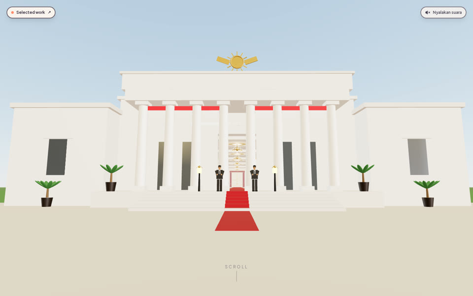
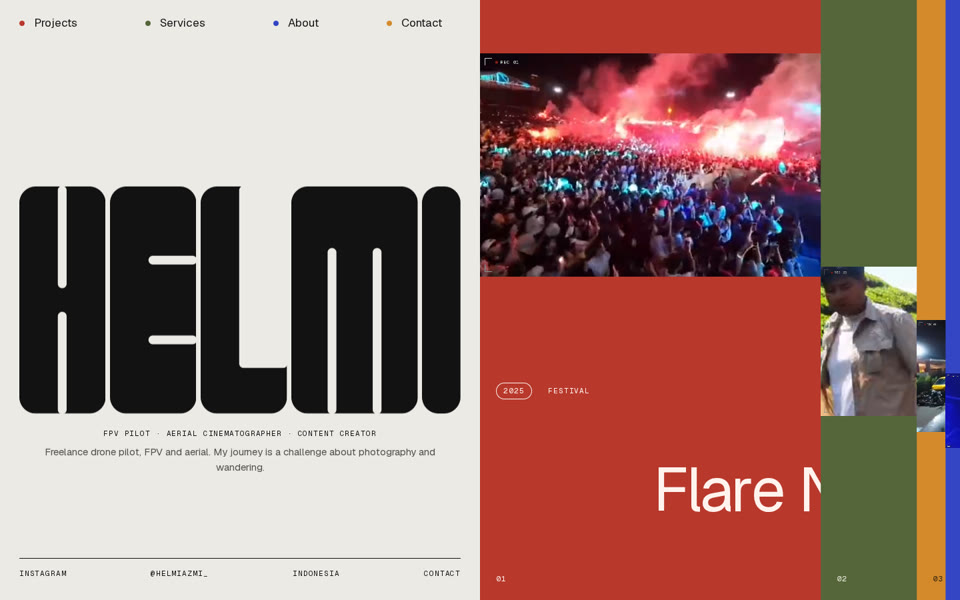
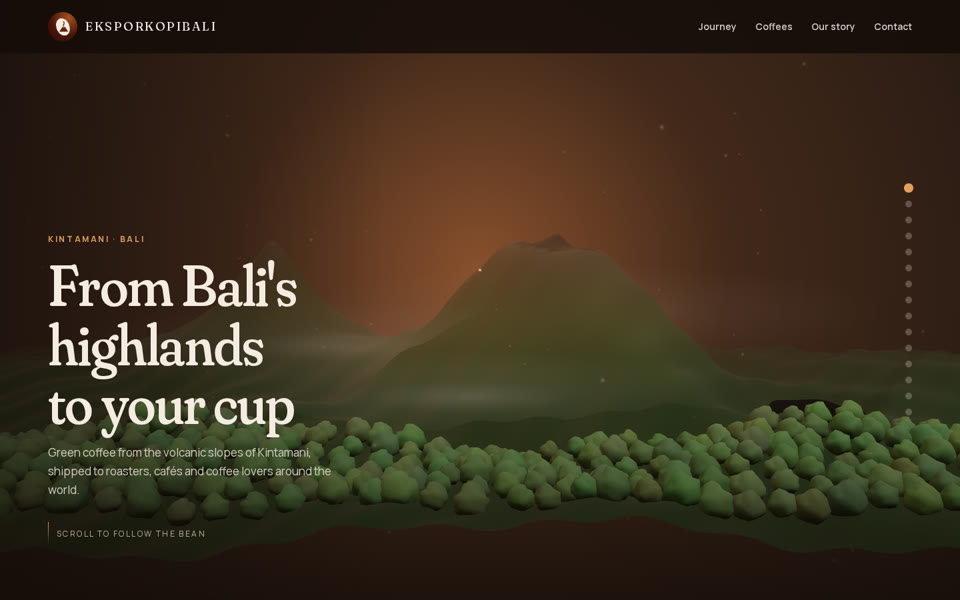
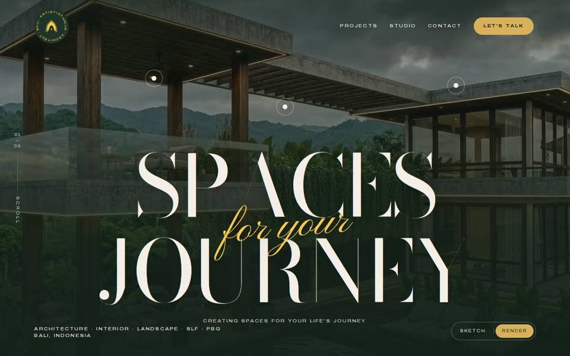

  

  
  
  
  

## 👋 About me

I'm Alex, an Information Systems student at **Telkom University**. I'm from Bali and now study in Bandung. I love tinkering with the newest tech and turning what I learn into things people can open, click and use. Outside the screen, I like traveling and exploring new places.

🇮🇩 *Halo, saya Alex, mahasiswa Sistem Informasi Telkom University asal Bali. Saya suka mengulik teknologi terbaru dan menjadikannya sesuatu yang bisa dibuka dan dipakai orang. Di luar layar, saya suka traveling.*

## 🔭 Spotlight: [alexdev.id](https://alexdev.id)

My own portfolio, and the project I'm proudest of: **a portfolio you walk through** instead of scroll past.

- 🏛️ **An interactive 3D palace tour.** Every door opens onto a different part of my story: skills, projects, internships and a timeline.
- 💬 **An AI assistant** that answers questions about me, so visitors can ask instead of hunting.
- 📱 **A light phone version** with a tappable door list, and a [Selected work](https://alexdev.id/projects) page that shows my websites in browser frames you can scroll through and open live.
- 🧱 Built with Next.js, React Three Fiber, Three.js, GSAP and TypeScript.

## ✨ More work

<table>
  <tr>
    <td width="33%" valign="top">
       
      <b>Helmi Azmi</b> 
      Portfolio for an FPV pilot: a scroll-driven film story, page transitions and a 3D drone.
    </td>
    <td width="33%" valign="top">
       
      <b>EksporKopiBali</b> 
      A green coffee exporter's site: a 3D journey of one bean from a Kintamani farm to a cup.
    </td>
    <td width="33%" valign="top">
       
      <b>Artisticthrive Architect</b> 
      An architecture studio's site: sketch-to-render hero, scroll animation and a project gallery.
    </td>
  </tr>
</table>

## 🌱 Currently exploring

Starting from the fundamentals, one small page at a time:

- 🧱 **HTML**: the structure of a page, from scratch
- 🎨 **CSS**: layout, spacing and responsive design, from scratch

📓 Follow along: **[html-css-learning](https://github.com/allekxx-cpu/html-css-learning)**, my 28-day plan with daily notes in my own words.

## 🧭 How I build

I build with AI-assisted tools, and now I'm learning the fundamentals so I truly understand what I ship.

## 🎯 Goals

- Learn HTML and CSS properly and build a few pages entirely by hand
- Join a tech community and learn together with others
- Build my first project end to end, written by me

## 🧰 What I work with

  
  
  
  
  
  
  
  
  
  
  

## 🎓 Along the way

- **Telkom University**: Bachelor of Information Systems (class of 2026)
- **SMK Negeri 1 Denpasar**: Software Engineering, graduated 2026
- **Balinesia Tech**: software engineering intern (2025)
- **Telkom Indonesia Denpasar**: administrative intern (2025)

## 🤝 Open to

**Internships**, **freelance projects** and **student & tech communities** where I can build, share and grow with others. If you have something in mind, I'd love to hear it.

  
  

---

Most of my repositories are private (client work). The live sites are the best way to see what I build. ✨

